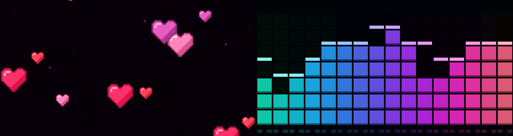
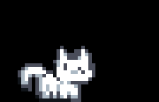
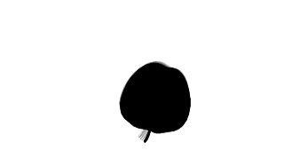

# HAIRCLIP / LAB

**Pixel animations for a wearable LilyGO T-Display-S3, with an interactive offline browser simulator.**

[**▶ Open live simulator**](https://materacl.github.io/display-hair-clip/preview.html)

Turn a tiny display into an animated hair clip: floating hearts, scrolling moods, a walking cat, and more. Preview scenes on a clickable model of the board before flashing the hardware.



[Browser simulator](#browser-simulator) · [Flash the board](#flash-the-board) · [Controls](#controls) · [Customize](#customize)

## Features

- Eight looping scenes on a **320 × 170** landscape display.
- Physical buttons for scene navigation and brightness adjustment.
- Temporary page dots and a rounded brightness indicator that hide automatically.
- A monochrome pixel interface with an interactive board, scene picker, pause button, and keyboard controls.
- Shared sprite assets for firmware and simulator; no network or SD card required for playback.

## Scenes

1. **Hearts** — floating pixel hearts with highlights, shadows, and twinkling sparks.
2. **HUNGRY :(** — large red scrolling text.
3. **FED :)** — large mint scrolling text.
4. **I LOVE MY BF** — scrolling lettering with a beating pixel heart.
5. **Equalizer** — colorful pixel bars spanning the screen. Decorative animation; it does not react to sound.
6. **Cat** — a white pixel cat with green eyes walking from right to left.
7. **Bad Apple!!** — a silent video loop: a spinning apple, the witch catching it, and a broom flight.
8. **Loading** — a large monochrome pixel spinner with no caption.

<p>
  
  
</p>

## Browser simulator

**[Try the live simulator on GitHub Pages](https://materacl.github.io/display-hair-clip/preview.html)** — no download or installation required.

To use the simulator offline:

1. Clone the repository or download and extract its ZIP archive.
2. Open **[preview.html](preview.html)** in a desktop browser.
3. Click the buttons on the board or choose a scene below it.

No installation, build step, or web server is needed. Keep `simulator.css`, `tokens.css`, and `assets/fonts/` alongside the HTML file. Images used during playback are embedded in the page. The simulator always starts at maximum brightness.

**Keyboard shortcuts**

- **Left / Right:** previous / next scene; hold to dim / brighten.
- **1–8:** select a scene directly.
- **P:** pause or resume animation.
- **R:** restart from the first scene at maximum simulator brightness.

The simulator previews animation layout and timing. Actual panel brightness, refresh behavior, and button feel depend on the hardware.

## Hardware

Designed for the standard **LilyGO T-Display-S3 with the ST7789 LCD**: ESP32-S3, 16 MB flash, 8 MB OPI PSRAM, and a 1.9-inch display. See the [official board repository](https://github.com/Xinyuan-LilyGO/T-Display-S3) for specifications and pinouts.

Hold the board horizontally with its buttons on the **right**: **USER** at the top and **BOOT** at the bottom. This firmware targets the LCD board; other T-Display models may use different display drivers or pins.

You need the board and a USB-C cable that supports data to flash and try the project. The repository contains the firmware and simulator; a physical clip mount is not included.

## Controls

- **USER — GPIO14, top right:** tap for the next scene; hold to increase brightness.
- **BOOT — GPIO0, bottom right:** tap for the previous scene; hold to decrease brightness.
- **RST:** restart the board.

A hold starts after 200 ms of a debounced press. Brightness changes by 4 every 60 ms within a range of 20–255. Releasing after a hold does not change the scene.

The brightness bar hides 1.2 seconds after the last adjustment. Scene dots hide 1.5 seconds after a scene change. Firmware starts at brightness **150**; the simulator starts at **255**.

Holding **BOOT** while resetting puts the ESP32 into download mode for flashing.

## Flash the board

### 1. Install Arduino and dependencies

1. Install [Arduino IDE 2](https://www.arduino.cc/en/software/).
2. In **File → Preferences → Additional Boards Manager URLs**, add:

   ```text
   https://raw.githubusercontent.com/espressif/arduino-esp32/gh-pages/package_esp32_index.json
   ```

3. Install **esp32 by Espressif Systems** through **Boards Manager**.
4. Install **LovyanGFX** through **Library Manager**.
5. Download [LilyGo-display-library](https://github.com/Xinyuan-LilyGO/LilyGo-display-library) using **Code → Download ZIP**, then install it with **Sketch → Include Library → Add .ZIP Library**.
6. Apply the compatibility adjustment below if the downloaded board profile still uses `cfg.i2s_port`.

The local development setup uses **ESP32 core 3.3.12** and **LovyanGFX 1.2.32**, with the LilyGO board profile adjustment described below.

### LilyGO / LovyanGFX compatibility

The [upstream T-Display-S3 profile](https://github.com/Xinyuan-LilyGO/LilyGo-display-library/blob/main/src/LilyGo_T_Display_S3.h) may still contain an older parallel-bus configuration field. For LovyanGFX 1.2.32, open the installed library's `src/LilyGo_T_Display_S3.h` and replace:

```cpp
cfg.i2s_port = I2S_NUM_0;
```

with:

```cpp
cfg.port = 0;
```

This resolves the errors `config_t has no member named i2s_port` and `I2S_NUM_0 was not declared`. The change is in the installed library, not in the sketch. If the profile already uses `cfg.port`, no edit is needed. Reinstalling the library may overwrite this adjustment.

### 2. Configure the board

Open **[Hairclip/Hairclip.ino](Hairclip/Hairclip.ino)**. Keep `Controls.h` and `AnimationAssets.h` in the same folder.

Select these options under **Tools** (labels may vary slightly by ESP32 core version):

- **Board:** ESP32S3 Dev Module
- **USB CDC On Boot:** Enabled
- **USB Mode:** CDC and JTAG
- **CPU Frequency:** 240 MHz
- **Flash Size:** 16 MB
- **Flash Mode:** QIO 80 MHz
- **PSRAM:** OPI PSRAM
- **Partition Scheme:** 16M Flash (3MB APP/9.9MB FATFS)
- **Upload Mode:** UART0 / Hardware CDC
- **Upload Speed:** 921600
- **Port:** the port that appears when the board is connected

### 3. Upload

Connect the board using a USB data cable and click **Upload**. After `Hash of data verified` and the reset message, the first animation should start. Press **RST** if it does not restart automatically.

If uploading stalls at `Connecting...`, hold **BOOT**, press and release **RST**, then release **BOOT** and retry. If the port changes in download mode, select the new port. Lower the upload speed to **115200** if the connection is unreliable.

## Customize

### Firmware and controls

- `Hairclip/Hairclip.ino` contains scene rendering, display orientation, and brightness limits.
- `Hairclip/Controls.h` contains debounce, tap, and hold logic.
- `preview.html` contains the browser scene implementations and simulator controls.
- `simulator.css` and `tokens.css` define the simulator's appearance.

`display.begin(1, brightness)` selects the landscape orientation. Rotation `3` flips it by 180 degrees. Changes to procedurally drawn scenes must be applied to both the firmware and browser renderer to keep them aligned.

### Shared animation assets

The generated assets are already committed; Python is only needed when editing or rebuilding them.

```sh
python -m pip install Pillow
python tools/build_animation_assets.py
```

The generator writes sprite sheets in `assets/`, the RGB565 animation data in `Hairclip/AnimationAssets.h`, and embedded PNG data in `preview.html`. It also checks encoded pixels and animation loop properties. The cat and beating heart each use 32 frames.

### Bad Apple loop

The video scene uses **93 frames at 15 fps**, making a **6.2-second loop**. The source segment is 12.4–19.0 seconds, scaled to fill the display width and vertically cropped with smooth apple tracking. A short crossfade joins the end to the beginning; the transition between silhouettes remains briefly visible.

To reimport from a local copy of the source video, install **FFmpeg / FFprobe** and **Pillow**, then run:

```sh
python tools/import_bad_apple.py path/to/badapple.mp4
python tools/build_animation_assets.py
```

Source metadata and its SHA256 are recorded in [assets/bad-apple-source.json](assets/bad-apple-source.json). The original full video is not included.

### Button logic checks

The existing compile-time checks cover debounce, tap/hold behavior, irregular polling, startup state, and `millis()` wraparound:

```sh
g++ -std=c++17 -Wall -Wextra -Werror -fsyntax-only checks/controls_check.cpp
```

These checks do not validate the display driver or physical backlight. Compile the full sketch in Arduino IDE and check it on the board after hardware-facing changes.

## Project layout

```text
Hairclip/
  Hairclip.ino              Arduino firmware and scene renderers
  Controls.h               Button state machine
  AnimationAssets.h        Generated RGB565 animation data
assets/
  fonts/                   Local Pixelify Sans font and OFL license
  *.png                    Shared sprite sheets and preview images
  *-preview.gif            Animated scene previews
  bad-apple-source.json     Video source metadata
checks/
  controls_check.cpp       Compile-time input checks
tools/
  build_animation_assets.py
  import_bad_apple.py
preview.html               Offline simulator and embedded animation assets
simulator.css              Simulator layout and board styling
tokens.css                 Pixel interface design tokens
```

## Credits and third-party assets

- **LilyGO** — [T-Display-S3 hardware reference](https://github.com/Xinyuan-LilyGO/T-Display-S3) and [display library](https://github.com/Xinyuan-LilyGO/LilyGo-display-library). The simulator board illustration is based on the board's appearance, with simplified details.
- **LovyanGFX** — [display graphics library](https://github.com/lovyan03/LovyanGFX).
- **Pixelify Sans** — [font source](https://github.com/google/fonts/tree/main/ofl/pixelifysans), distributed under the SIL Open Font License. A copy is included in [assets/fonts/OFL-PixelifySans.txt](assets/fonts/OFL-PixelifySans.txt).
- **Bad Apple!!** — shadow-art PV by Anira; music by Alstroemeria Records / nomico; Touhou by ZUN. [Video source used for the excerpt](https://github.com/bad-apple-lab/Bad-Apple/blob/main/badapple.mp4). No audio is included.

Third-party media and dependencies retain their respective rights and licenses. Attribution does not grant redistribution rights to the Bad Apple footage. No blanket license is applied to those assets by this repository.
